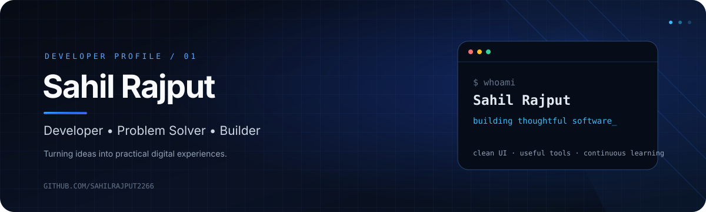



 

### Building useful things. Learning every day.

*Turning ideas into practical, thoughtful digital experiences with clean code.*

---

## `01 / About`

Hi, I'm **Sahil Rajput** — a Full-Stack Web Developer who enjoys building scalable web applications and crafting pixel-perfect, interactive digital experiences.

- 🔭 **Currently working on:** [JobOrbit](https://github.com/SahilRajput2266/JobOrbit) *(Full-stack career portal)* & [Zavio](https://github.com/SahilRajput2266/Zavio) *(Real-time multiplayer chat platform)*
- 🌱 **Currently learning:** Advanced Microservices Architecture, Next.js, and System Design
- 🧩 **Interested in:** Full-Stack Architecture, Real-Time WebApps, RESTful APIs, and responsive UI/UX
- 🤝 **Open to:** Full-stack developer opportunities, innovative collaborations, and impactful open-source projects

---

## `02 / Featured projects`

  <table>
    <tr>
      <td width="50%" valign="top">
        <h3>🚀 JobOrbit</h3>
        
<strong>Full-Stack Job & Career Platform</strong>

        
Comprehensive career portal featuring advanced job search filters, applicant tracking, and real-time status management.

        
<code>React</code> <code>Node.js</code> <code>Express</code> <code>MongoDB</code>

        <a href="https://github.com/SahilRajput2266/JobOrbit">View repository →</a>
      </td>
      <td width="50%" valign="top">
        <h3>⚡ Zavio (novachat)</h3>
        
<strong>Real-Time Multiplayer & Chat Application</strong>

        
Real-time communication hub with instant WebSockets messaging, live interactive multiplayer games (Ludo, Teen Patti), and ticket support.

        
<code>React</code> <code>Socket.io</code> <code>Node.js</code> <code>MongoDB</code>

        <a href="https://github.com/SahilRajput2266/Zavio">View repository →</a>
      </td>
    </tr>
    <tr>
      <td width="50%" valign="top">
        <h3>🛠️ Cryptocurrency Tracker</h3>
        
<strong>Live Market Analytics & Dashboard</strong>

        
Real-time cryptocurrency tracking dashboard monitoring live prices, market cap shifts, and performance trends via live financial APIs.

        
<code>JavaScript</code> <code>REST APIs</code> <code>HTML5</code> <code>CSS3</code>

        <a href="https://github.com/SahilRajput2266/cryptocurrency-tracker">View repository →</a>
      </td>
      <td width="50%" valign="top">
        <h3>💡 Footwear E-Commerce</h3>
        
<strong>Interactive Online Retail Storefront</strong>

        
Modern e-commerce shopping experience featuring intuitive catalog filtering, cart management, and seamless responsive checkout flows.

        
<code>JavaScript</code> <code>HTML5</code> <code>CSS3</code>

        <a href="https://github.com/SahilRajput2266/Footwears">View repository →</a>
      </td>
    </tr>
  </table>

---

## `03 / Tech stack`

  

 

**Core strengths:** `JavaScript (ES6+)`, `React.js`, `Node.js`, `Express.js`, `MongoDB`, `MySQL`, `REST APIs`

**Currently exploring:** `Next.js`, `Microservices Architecture`, `Docker`, `System Design`

---

## `04 / GitHub analytics`

  
  

  

These cards fetch live data from GitHub and reflect contributions across all repositories.

---

## `05 / Let's connect`

 

*Have an interesting idea or project? Let's build something useful together.*

---

  Designed with precision, clean code & curiosity.

