<div align="center">

<!-- Hero Banner (SVG) -->


<br/><br/>

<!-- Dynamic Animated Typing Text -->
<a href="https://github.com/SahilRajput2266">
  
</a>

<br/>

<!-- Quick Social Badges & Status -->
<p align="center">
  <a href="https://www.linkedin.com/in/sahil-chauhan-6bb687237" target="_blank">
    
  </a>
  <a href="mailto:sahilrajput6244@gmail.com">
    
  </a>
  <a href="https://github.com/SahilRajput2266">
    
  </a>
  
</p>

<p align="center">
  
  
  
  
</p>

</div>

---

### 👨‍💻 `01 // SYSTEM OVERVIEW`

```yaml
Developer: Sahil Chauhan (Sahil Rajput)
Title: Full-Stack Software Engineer & Digital Architect
Core Stack: React.js, Next.js, Node.js, Express, MongoDB, Socket.IO, TypeScript
Passions: Ultra-low latency communication, intuitive UI/UX, and robust distributed backends
Philosophy: "Engineered for speed, built for scale, crafted with precision."
Location: India 🇮🇳
Availability: Open for High-Impact Roles, Collaborations & Scalable Projects 🚀
```

- 🔭 **Currently Pioneering:**
  - **Zavio** — Titanium-grade real-time messaging ecosystem featuring sub-8ms edge WebSockets, dual-mode glassmorphism, multiplayer minigames, and 1-click PWA mobile install. *(Private Production)*
  - **[PulseChat](https://github.com/SahilRajput2266/PulseChat)** — Multi-tenant WhatsApp Web platform enabling team-wide messaging from unified or individual numbers with strict zero-leak chat isolation and permanent document archiving.
  - **[JobOrbit](https://github.com/SahilRajput2266/JobOrbit)** — Full-featured career search engine and applicant tracking ecosystem (ATS) with live application pipeline analytics.
  - **ApexERP & NexusCRM** — Enterprise-grade Resource Planning and Sales CRM suite with multi-warehouse inventory, automated invoicing, RBAC security, and real-time financial reporting. *(Enterprise NDA)*
- 🌱 **Diving Deep Into:** Distributed System Design, Microservices Architecture, Redis In-Memory Caching, and Next.js 15 App Router.
- 💬 **Ask Me About:** MERN Stack, WhatsApp Web APIs (Baileys), ERP/CRM architecture, WebSocket clustering, RESTful APIs, Tailwind CSS animations, and authentication workflows.
- ⚡ **Fun Fact:** I don't just write code — I build digital engines where performance meets luxury aesthetics.

---

### 🚀 `02 // FEATURED FLAGSHIP REPOSITORIES`

<div align="center">
<table width="100%">
  <tr>
    <td width="50%" valign="top">
      <h3 align="center">⚡ Zavio</h3>
      <p align="center"><strong>High-Velocity Real-Time Messaging & Multiplayer Social Hub</strong></p>
      <p align="center">
        
        
        
      </p>
      <ul>
        <li><b>Instant WebSockets:</b> Sub-millisecond synchronous message delivery, live presence ticks, typing indicators.</li>
        <li><b>Integrated Minigames:</b> Full-state in-thread Chess, Tic-Tac-Toe, Saanp Seedhi, Connect 4, Wordle.</li>
        <li><b>Dual-Mode UI:</b> Obsidian Titanium Dark mode and Crystal Porcelain Light mode.</li>
        <li><b>Mobile PWA Ready:</b> Standalone native app install directly onto Android, iOS, or Desktop without app store friction.</li>
      </ul>
      <p align="center">
        <code>React 18</code> &bull; <code>Node.js</code> &bull; <code>Express</code> &bull; <code>Socket.io</code> &bull; <code>MongoDB</code> &bull; <code>TailwindCSS</code> &bull; <code>Vite</code>
      </p>
      <div align="center">
        
      </div>
    </td>
    <td width="50%" valign="top">
      <h3 align="center">💬 PulseChat</h3>
      <p align="center"><strong>Multi-Tenant WhatsApp Web Gateway & Secure Data Vault</strong></p>
      <p align="center">
        
        
        
      </p>
      <ul>
        <li><b>Unified WhatsApp Gateway:</b> Connect a single central business WhatsApp for multiple sub-users, or link individual personal accounts.</li>
        <li><b>Strict Chat & Contact Privacy:</b> Complete tenant isolation — users cannot view each other's chats or contacts even on the same shared number.</li>
        <li><b>Permanent Cloud Storage:</b> Secure, long-term archival for all messages, chats, images, audio notes, and document attachments (PDFs).</li>
        <li><b>Real-Time Media Engine:</b> Live delivery status ticks (sent, delivered, read), responsive contact manager, and instant lightbox media previews.</li>
      </ul>
      <p align="center">
        <code>TypeScript</code> &bull; <code>Node.js</code> &bull; <code>Baileys</code> &bull; <code>React</code> &bull; <code>Socket.io</code> &bull; <code>MongoDB</code> &bull; <code>TailwindCSS</code>
      </p>
      <div align="center">
        <a href="https://github.com/SahilRajput2266/PulseChat">
          
        </a>
      </div>
    </td>
  </tr>
  <tr>
    <td width="50%" valign="top">
      <h3 align="center">🎯 JobOrbit</h3>
      <p align="center"><strong>Full-Stack Career Search & ATS Intelligence Platform</strong></p>
      <p align="center">
        
        
        
      </p>
      <ul>
        <li><b>Dynamic Career Search:</b> Granular multi-filter query system for roles, compensation, and tech stacks.</li>
        <li><b>Applicant Pipeline:</b> End-to-end recruitment lifecycle from application to stage-based feedback.</li>
        <li><b>Resume & Profile Hub:</b> Cloud asset storage, verified developer metrics, and employer analytics.</li>
        <li><b>Real-Time Alerts:</b> Automated notification dispatch on application status updates.</li>
      </ul>
      <p align="center">
        <code>React</code> &bull; <code>Node.js</code> &bull; <code>Express</code> &bull; <code>MongoDB</code> &bull; <code>REST APIs</code> &bull; <code>JWT</code>
      </p>
      <div align="center">
        <a href="https://github.com/SahilRajput2266/JobOrbit">
          
        </a>
      </div>
    </td>
    <td width="50%" valign="top">
      <h3 align="center">🏢 ApexERP & NexusCRM</h3>
      <p align="center"><strong>Enterprise Resource Planning & Sales Acceleration Ecosystem</strong></p>
      <p align="center">
        
        
        
      </p>
      <ul>
        <li><b>Inventory & Invoicing:</b> Multi-location stock monitoring, automated low-stock triggers, PDF invoicing, payment reconciliation.</li>
        <li><b>Visual Deal Pipeline:</b> Drag-and-drop Kanban boards with custom deal stages, probability weights, and sales forecasting.</li>
        <li><b>Role-Based Access (RBAC):</b> Granular permissions across Admin, Inventory Manager, Accountant, and Auditor roles.</li>
        <li><b>360° Customer Profiles:</b> Complete contact history, call/meeting logs, email threads, and live executive KPI dashboards.</li>
      </ul>
      <p align="center">
        <code>React</code> &bull; <code>Node.js</code> &bull; <code>Express</code> &bull; <code>MongoDB</code> &bull; <code>Redux Toolkit</code> &bull; <code>Chart.js</code>
      </p>
      <div align="center">
        
      </div>
    </td>
  </tr>
</table>
</div>

---

### 🛠️ `03 // ARSENAL & TECH STACK`

<div align="center">

<!-- Visual Skill Icons Bar -->
<a href="https://skillicons.dev">
  
</a>

<br/><br/>

| Layer | Technologies, Frameworks & Tooling |
| :--- | :--- |
| **Frontend Architecture** | `React 18`, `Next.js 14/15`, `TypeScript`, `JavaScript (ES6+)`, `Tailwind CSS`, `Redux Toolkit`, `Framer Motion`, `HTML5 / CSS3` |
| **Backend & Real-Time** | `Node.js`, `Express.js`, `Socket.IO`, `WebSockets`, `REST APIs`, `JWT Security`, `Middleware Engineering` |
| **Database & Storage** | `MongoDB`, `Mongoose ODM`, `MySQL`, `Cloudinary CDN`, `IndexedDB` |
| **Engineering Workflow** | `Git`, `GitHub Actions`, `Postman`, `Vite`, `VS Code`, `npm / yarn`, `Vercel`, `Linux Shell` |

</div>

---

### 📊 `04 // LIVE GITHUB ACTIVITY & METRICS`

<div align="center">

<table border="0">
  <tr>
    <td align="center" width="50%">
      
    </td>
    <td align="center" width="50%">
      
    </td>
  </tr>
  <tr>
    <td colspan="2" align="center">
      
    </td>
  </tr>
</table>

</div>

---

### 📬 `05 // LET'S CONNECT & COLLABORATE`

<div align="center">

<p>Whether you're looking to build a high-performance web app, discuss software architecture, or explore new opportunities, my inbox is always open!</p>

<p>
  <a href="https://www.linkedin.com/in/sahil-chauhan-6bb687237" target="_blank">
    
  </a>
  &nbsp;&nbsp;
  <a href="mailto:sahilrajput6244@gmail.com">
    
  </a>
  &nbsp;&nbsp;
  <a href="https://github.com/SahilRajput2266">
    
  </a>
</p>

<br/>

```javascript
const developer = {
  name: "Sahil Chauhan",
  status: "Always building, always learning",
  coffeeToCodeRatio: Infinity
};

console.log("Let's build something remarkable together! 💙");
```

<br/>

<sub>Crafted with passion &bull; © 2026 Sahil Chauhan</sub>

</div>
